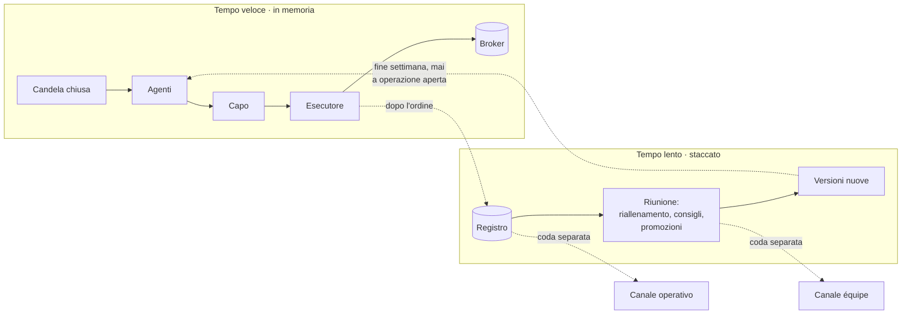

# Il piano

**Obiettivo:** un'équipe di agenti che applica il **CRT di RomeoTPT**
(@Romeotpt) e impara dagli esiti, sullo storico e dal vivo, quali segnali
contano davvero. Migliora solo quando lo dimostra su dati che non ha mai
visto.

Il progetto riparte da zero il 24 settembre 2026. Il lavoro precedente resta
intatto sul branch `claude/trading-bot-infrastructure-5rht0h`, come archivio:
non si cancella, e se serve si ripesca un pezzo. Da lì vengono anche le idee
migliori del vecchio piano ("Piano: da bot a intelligenza che impara"): i
pesi in ombra, il freno d'emergenza, lo spread × 1,5, le varianti dichiarate
prima.

Si riparte perché il progetto precedente girava in un ciclo: si misurava, il
numero usciva negativo, si trovava un errore, si correggeva, usciva positivo
su pochi casi, si andava in produzione, si scopriva un altro errore e si
tornava sotto zero. In nove giorni il giudizio sulla strategia è cambiato una
decina di volte, e una correzione del 23/09 ha rotto tre conferme su otto.
Le regole in fondo a questo file esistono per non rifarlo.

---

## 1. L'équipe

Il bot è un gruppo di agenti. Ognuno risponde a **una domanda sola**, guarda
**solo i dati** (non i pareri degli altri) e parte dal **manuale**: la regola
di Romeo scritta nella sua scheda in `spec/`. Un agente cambia il suo modo di
lavorare solo quando dimostra, su dati che non ha mai visto, di fare meglio
del manuale (vedi §2).

| Agente | La sua domanda | Da dove parte | Cosa può imparare |
|---|---|---|---|
| **Cacciatore** | C'è un CRT sul timeframe alto, e il prezzo lo sta manipolando? | la definizione di Romeo nella sua scheda, verificata sui casi annotati | all'inizio niente: la definizione è fissa. Più avanti, le soglie (es. quanto deve essere profonda la manipolazione) |
| **Grilletto** | Il Model#1 è scattato sul timeframe basso? | il Model#1 di Romeo: turtle soup e chiusura oltre il livello CISD | le soglie del suo modello |
| **Conferme** (un agente per conferma di Romeo) | Questa conferma c'è? | la regola della sua scheda | la soglia della sua conferma |
| **Contesto** | Il momento è favorevole? (dollaro, sessione, notizie) | la regola della sua scheda | quanto conta il contesto |
| **Livelli** | Dove vanno stop, primo target e target finale? | la regola della sua scheda | le distanze |
| **Rischio** | Quanto si rischia, e quanto costa entrare? | percentuale fissa, costi misurati | la stima dei costi per ora e per strumento |
| **Sentinella** | Quando si va a pareggio, quando si prende il parziale? | la regola della sua scheda | i punti di pareggio e parziale, guardando il percorso di ogni operazione |
| **Capo** (l'algoritmo che sta sopra tutti) | Tutto considerato, conviene entrare? | entra se ci sono tutte le conferme obbligatorie | quanto fidarsi di ogni agente |
| **Cronista** | — | scrive nei due canali Telegram (§1, "I due canali Telegram"), in italiano semplice | niente |
| **Esecutore** | — | manda l'ordine al broker (solo dalla Fase H) e registra **prezzo e motivo di ogni chiusura, letti dal broker** | niente |

Il Capo non decide con una soglia fissa: stima la probabilità `p` che
l'operazione arrivi al target ed entra solo se

    p × RR − (1 − p) − costi > 0

cioè solo se, in media, l'operazione paga più di quanto costa. Il Capo è un
modello che si legge (una regressione logistica): per ogni agente si vede
quanto pesa, e se ne può discutere.

L'Esecutore registra le chiusure dal broker perché senza prezzo e motivo di
uscita l'R non si calcola, e dal vivo non si impara niente. Nel vecchio bot
25 chiusure su 27 avevano il motivo sbagliato.

### La carriera

Ogni agente entra come un neolaureato in un'azienda: fa il suo lavoro come
dice il manuale, e sale di grado solo quando l'esperienza dimostra che sa
fare meglio.

| Grado | Cosa vuol dire | Come ci si arriva |
|---|---|---|
| **Neolaureato** | applica la regola di Romeo alla lettera | è il punto di partenza di tutti |
| **In prova** | ha una versione nuova che gira in ombra: decide, ma senza operare | il riallenamento ha trovato qualcosa che sullo storico batte la versione in uso |
| **Promosso** | la sua versione nuova opera davvero | la prova in ombra ha superato il cancello (§2) |
| **Retrocesso** | torna alla versione precedente | dal vivo va peggio di quanto previsto |

Il Capo fa carriera allo stesso modo. All'inizio vuole tutte le conferme
obbligatorie, come dice Romeo. Con l'esperienza impara di chi fidarsi di
più e di chi di meno.

### I due tempi

- **Il tempo veloce** apre le operazioni. Tutto in memoria, dentro un solo
  programma: candela → agenti → Capo → Esecutore. Prima dell'ordine non si
  aspetta niente di lento: niente rete tranne il broker, niente Telegram,
  niente ragionamenti lunghi. Obiettivo iniziale: meno di mezzo secondo
  dalla chiusura della candela all'ordine inviato, misurato su ogni ordine.
- **Il tempo lento** è la riunione. È staccato dall'apertura e gira quando
  le operazioni si chiudono e ogni fine settimana. Qui gli agenti si
  riallenano, si scambiano consigli e si decidono le promozioni. Può
  metterci minuti: nessun ordine lo aspetta.

### I consigli fra agenti

Nel tempo veloce gli agenti non si influenzano: ognuno risponde alla sua
domanda senza sapere cosa dicono gli altri.

Nella riunione invece si danno consigli, perché ognuno vede cose che gli
altri non vedono. Esempio: la Sentinella vede il percorso di ogni
operazione, e nota che in 6 stop su 10 il prezzo è andato di poco oltre lo
stop e poi è arrivato al target. Lo dice ai Livelli: "forse lo stop è troppo
stretto".

**Un consiglio non è un ordine: è un'ipotesi.** Va nel registro, e solo
l'agente responsabile di quel numero può provarla, con i suoi dati e con il
cancello. Se passa, l'agente entra in prova. Se non passa, il consiglio resta
scritto insieme al numero che l'ha bocciato. Così nessuno cambia perché "un
altro l'ha detto", ma solo perché i dati gli danno ragione.

### I due canali Telegram

| Canale | Cosa ci si legge |
|---|---|
| **Operativo** | l'avvio del bot; ogni decisione di aprire un'operazione, con il perché agente per agente; ogni chiusura, con prezzo, motivo e risultato; gli avvisi urgenti (stop colpito, freno d'emergenza) |
| **Équipe** | **solo** la comunicazione fra gli agenti: consigli, prove, promozioni e bocciature, con i numeri. È sempre attivo, ma il suo momento principale è il rendiconto del fine settimana, a mercati chiusi |

Il canale operativo resta pulito: lì arriva solo quello che riguarda le
operazioni, e un avviso urgente non si perde in mezzo ai consigli.

I messaggi del canale operativo partono **dopo** che l'ordine è stato
inviato, mai prima. Su Telegram un bot non può leggere i messaggi degli
altri bot, quindi la discussione dell'équipe avviene dentro il programma, e
il canale la mostra. Tutti i messaggi escono da una coda separata: se
Telegram è lento o non risponde, nessun ordine aspetta.

---

## 2. Come imparano gli agenti

Gli agenti imparano in due modi: **sullo storico** e **dal vivo**. In
entrambi i casi un valore nuovo entra in uso solo se supera **il cancello**.

### Il cancello

Un agente passa alla versione nuova solo se, su dati che non ha visto
durante l'allenamento:

1. ha almeno il numero minimo di casi scritto nella sua scheda;
2. migliora il suo risultato di almeno la soglia scritta nella sua scheda;
3. l'intervallo di confidenza al 95% del miglioramento non contiene lo zero
   (calcolato a blocchi: due operazioni che si sovrappongono nel tempo, o
   sulla stessa valuta nello stesso momento, contano come una);
4. il miglioramento ha lo stesso segno in almeno l'80% degli anni;
5. **più tentativi, asticella più alta.** Ogni candidato provato va nel
   registro. Con K candidati, al posto del 95% si chiede 1 − 5%/K.

Se non passa, l'agente resta alla versione di prima. Il manuale è sempre il
punto di partenza, quindi un agente che non impara niente fa esattamente
quello che dice la sua scheda.

### Sullo storico

Walk-forward anno per anno: l'agente si allena su tutto quello che viene
prima di un anno e viene giudicato su quell'anno, poi si passa al
successivo. Il periodo **2024–2026 resta chiuso** e si apre una volta sola,
nella Fase G.

Un test automatico controlla che nessun agente sbirci il futuro: ogni
valore calcolato sull'archivio completo deve essere identico a quello
calcolato sull'archivio tagliato all'istante della decisione.

### Dal vivo

- Ogni candela, ogni parere di ogni agente e ogni esito vengono registrati,
  **anche per le operazioni non aperte**: si impara anche da quelle perse.
- Ogni fine settimana, a mercato chiuso, ogni agente si riallena su storico
  più dati dal vivo.
- **In ombra prima di tutto.** Una versione nuova gira in parallelo senza
  operare e registra cosa avrebbe deciso, finché non ha almeno 100 casi che
  non ha mai visto. Solo allora si confronta con quella in uso, e la
  sostituisce solo se vince di almeno 0,05 R con il cancello completo.
- Una versione non cambia mai durante un'operazione aperta: ogni operazione
  resta legata alla versione che l'ha aperta, e registra la versione di ogni
  agente. Si può sempre dire chi ha deciso cosa, e si può sempre tornare alla
  versione precedente.
- **Freno d'emergenza.** Se il risultato dal vivo scende sotto il 5° percentile
  di quello che lo storico aveva previsto, il bot si ferma da solo e lo scrive.
- Ogni promozione, e ogni mancata promozione, va nel registro con il numero
  che l'ha decisa.

Una nota onesta: dal vivo arrivano poche operazioni a settimana, e quindi
l'apprendimento dal vivo sarà lento. All'inizio il suo compito principale è
controllare che il bot dal vivo si comporti come aveva previsto lo storico.

---

## 3. Le fasi

Si passa alla fase successiva solo quando `STATO.md` dice che quella attuale
è chiusa, con il numero o la prova che la chiude.

| Fase | Cosa | Si chiude quando |
|---|---|---|
| **A. Specifica** | Si riscrive il CRT di Romeo **dalle sue fonti**, una scheda per agente, partendo dal Cacciatore. Dove le fonti non bastano, si dichiarano varianti. I casi si prendono dai grafici che Romeo ha pubblicato. | le regole del Cacciatore sono decise sulle fonti e ci sono i casi: obiettivo 20 CRT e 10 "sembra un CRT ma non lo è"; se non se ne trovano abbastanza, si scrive quanti sono |
| **B. Dati** | **Una sola fonte di prezzi** per tutti i timeframe, con lo stesso orario del broker. Storico con bid e ask, anche al minuto per le coppie veloci. Controlli: niente buchi, niente prezzi assurdi. | i dati passano i controlli, e sui mesi in comune i CRT trovati coincidono con quelli del broker almeno al 95% |
| **C. Cacciatore** | Il codice del Cacciatore, provato sui casi annotati. | trova il 100% dei casi CRT, esattamente lì, e scarta il 100% dei casi "non è un CRT" |
| **D. La base** | Si prendono tutti i CRT 2006–2023, con i costi veri. È il numero da battere. | il numero è scritto in `STATO.md` |
| **E. Gli altri agenti** | Uno alla volta: scheda → casi → codice → misura contro la base. | ogni agente ha la sua riga nella tabella di `STATO.md` |
| **F. Capo e apprendimento** | Il Capo impara di chi fidarsi, gli agenti imparano sullo storico, tutto dietro il cancello. Al massimo 3 varianti, dichiarate prima. La riunione gira sullo storico, e le carriere si vedono già nel canale équipe. | sì o no: la strategia batte la base di almeno 0,10 R per operazione, con i criteri del §2, e regge anche con lo spread × 1,5 |
| **G. Verifica finale** | Si apre il periodo 2024–2026, una volta sola. | conferma o smentita |
| **H. Dal vivo, in demo** | Esecutore, Sentinella dal vivo, apprendimento dal vivo, canale operativo. Conto demo con la **cifra che useresti davvero**. | almeno 8 settimane con risultati coerenti con la Fase G |

Il conto reale si considera solo dopo la Fase H, e solo con una tua
decisione esplicita.

### Dove ci si ferma

Scritto adesso, così non si può spostare il traguardo quando i numeri
deludono.

| Fase | Ci si ferma se | Cosa vuol dire |
|---|---|---|
| B | i CRT sulla fonte storica e sul broker coincidono meno del 95% | i dati sono sbagliati, non la strategia: si sistemano i dati |
| D | su una coppia di timeframe escono meno di 1.000 CRT | quella coppia non ha abbastanza casi per imparare: esce dal piano |
| F | niente batte la base di 0,10 R, oppure regge solo con lo spread stimato e non con lo spread × 1,5 | **il CRT di Romeo, così come è scritto, non guadagna dopo i costi.** Non si aggiungono regole per farlo passare: si decide cosa fare con quel numero davanti |
| F | vince sugli anni di allenamento e perde su quelli di verifica | ha imparato il rumore: si riduce e si riprova, un tentativo solo |
| G | il 2024–2026 non conferma | non si va dal vivo, qualunque cosa dicesse prima |
| H | il freno d'emergenza scatta | il bot si ferma da solo |

---

## 4. Le regole del gioco

Queste regole esistono perché ognuna corrisponde a un errore che il progetto
precedente ha fatto più volte.

1. **Prima le regole, poi il codice, poi i casi.** Niente codice prima che le
   regole della scheda siano decise, e il codice non si considera buono
   finché non passa i casi. *(Prima: il codice leggeva il CRT in modo diverso
   dalla specifica, e ce ne si è accorti dopo tre settimane.)*
2. **I casi annotati sono il metro.** I test controllano che il codice
   ritrovi i casi presi dai grafici, non che il codice faccia quello che fa
   già. Ogni correzione deve continuare a passare **tutti** i casi, non solo
   quello che l'ha fatta nascere. *(Prima: `07_casi.md` chiedeva 75 casi e
   ne conteneva zero, e la correzione del 23/09 al cercatore di CRT ha reso
   inutili tre conferme su otto senza che nessun test se ne accorgesse.)*
3. **Una regola, un posto.** Se la stessa regola è scritta in due punti del
   codice, prima o poi i due punti divergono. *(Prima: tre difetti in 24 ore
   da "due copie della stessa regola".)*
4. **I criteri si scrivono prima di guardare il risultato**, e non si
   cambiano dopo.
5. **Gli errori si cercano con la stessa cura sui numeri belli e su quelli
   brutti.** *(Prima: "ogni volta che un risultato è venuto negativo, la
   causa era un mio errore". Se si cercano errori solo quando il numero è
   brutto, prima o poi ne esce uno bello per caso.)*
6. **Ogni tentativo va nel registro**, anche quelli falliti
   (`registro/tentativi.md`). *(Prima: +0,29 R era la migliore di 128
   combinazioni su 43 operazioni, e con 128 tentativi un numero così esce
   anche tirando a caso.)*
7. **Nessun ordine, nemmeno in demo, prima della Fase H.** *(Prima: il bot
   veniva corretto mentre girava, e ogni correzione cambiava cosa misuravano
   le prove.)*
8. **Niente fuori piano.** Canali, pannelli, integrazioni nuove si annotano
   in fondo a `STATO.md` e si fanno quando tocca. *(Prima: un'ora dopo aver
   misurato che la base perdeva, si costruivano canali Telegram nuovi.)*
9. **Una sessione per fase.** Ogni sessione di lavoro parte leggendo
   `STATO.md` e `PIANO.md`, e prima di chiudere aggiorna `STATO.md`.
   *(Prima: una chat sola da 360.000 token, dove le conclusioni di dieci
   giorni prima non le teneva più a mente nessuno.)*
10. **I segreti non entrano mai nel repository**: token, chiavi, password
    stanno solo nel `.env` sul computer.
